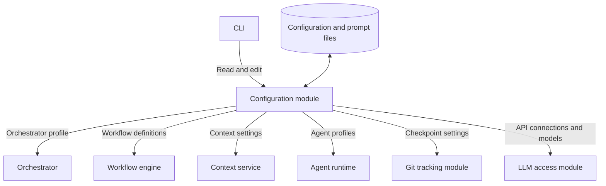

# Configuration module

[Main architecture](../architecture.md)

Stores prompts and settings for the orchestrator, agents, and other components, plus workflow definitions. Components load their configuration before execution. The CLI provides a way to inspect and edit it.

Implemented in [ariadne/configuration](../../ariadne/configuration/__init__.py), with tests in `tests/configuration/`. The orchestrator uses saved profiles and snapshots; agent execution remains separate work.

## Architecture



Configuration describes how a component behaves. Project knowledge supplies facts about the project; tasks describe the current work.

## Configuration data

`ID` and `Text` are strings; `?` means optional. The [Python data types](../../ariadne/configuration/model.py) define the current prototype schema.

| Record | Fields | Purpose |
| --- | --- | --- |
| Prompt | `id: ID`, `text: Text`, `variables: List<string>` | Reusable instructions or a template with named inputs. |
| API connection | `id`, `adapter`, `base_url`, `credential_ref` | Shared API endpoint and credential reference; OpenRouter is the first adapter. |
| Component profile | `id`, `description`, `component`, `prompt_ids`, optional `provider_id` and `model`, `tools`, `settings` | Settings for an orchestrator, agent, tool, context service, runtime, Git tracker, or workflow engine. |
| Workflow definition | `id`, `start`, `max_step_executions`, named `steps` | Agent order and rules for moving between steps. |

Profile `settings` hold component-specific values such as token budgets, timeouts, retrieval limits, or Git checkpoint settings. A workflow step references an agent profile and describes its inputs and transitions. Profile tool lists reference tools implemented by the runtime. The [Git tracker](git-tracking-module.md) loads its capture settings through `get_profile(id)` like other components.

Prompts may be shared by several profiles. The context service uses the selected instructions when preparing an agent's input. Workers receive the resulting instructions; they do not manage configuration.

A step contains an `agent_profile`, named `inputs`, and outcome-to-transition mappings. A transition targets another step or a terminal outcome: completed, blocked, cancelled, or failed. Review loops are allowed with a positive execution limit; unreachable steps, missing references, and steps without a path to an outcome are rejected.

Prompt text uses `{{variable}}` placeholders. Declared variables must match the template. Workflow steps must provide required inputs, and rendering checks actual values. Inserted values are treated as literal text, with no recursive template expansion.

## Interface

| Operation | Caller | Purpose |
| --- | --- | --- |
| `list_providers()` / `get_provider(id)` | Application, CLI | Load saved API connections. |
| `save_provider(provider, expected_revision?)` | CLI editor | Create or update an API connection. |
| `list_profiles(component?)` | CLI, orchestrator | Discover available component or agent profiles. |
| `get_profile(id)` | Orchestrator, context service, runtime, Git tracker | Load a component's settings and prompt references. |
| `get_prompt(id)` | Orchestrator, context service | Load prompt text and its expected variables. |
| `get_workflow(id)` | Workflow engine | Load a workflow definition. |
| `list_workflows()` | CLI, orchestrator | Discover available workflows. |
| `save_profile(profile, expected_revision?)` | CLI editor | Create or update a component profile. |
| `save_prompt(prompt, expected_revision?)` | CLI editor | Create or update prompt text and declared variables. |
| `save_workflow(definition, expected_revision?)` | CLI editor | Create or update a workflow. |
| `replace_configuration(configuration, expected_revision?)` | CLI editor | Publish coordinated prompt/profile/workflow changes together. |
| `create_snapshot()` / `get_snapshot(id)` | Application/runtime | Save or load a fixed configuration for a run. |
| `snapshot.render_profile(id, values)` | Application/context service | Resolve a profile's prompt text using that run's configuration. |

The orchestrator's LLM tools expose profile/workflow discovery and inspection. Configuration loading and saving are handled by application code; workers receive no configuration-editing tools. The CLI defaults to `reader`; saving requires `editor`. Missing references, required prompt inputs, and invalid known limit settings produce clear errors. Actual tool availability is checked against the runtime registry through `Configuration.validate_tools`.

## Storage

```text
.ariadne/
  config.json                # Versioned manifest: profiles, workflows, prompt references
  prompts/<id>-r<revision>-<token>.md
  snapshots/<snapshot-id>.json
  .write.lock
```

Save operations validate the candidate configuration, write new prompt revisions, and atomically publish the manifest. Cooperating editors use a file lock; `expected_revision` detects stale edits. Unchanged prompt files are reused. Use save operations for coordinated versioned edits.

Track `config.json` and prompt files in Git. Saved snapshots contain their own complete prompt text and stay unchanged when live configuration is edited. Record the snapshot ID with each future run. Snapshots and lock files are runtime artifacts ignored by the default Git rules. Old prompt revisions are retained; cleanup policy is still open.

Credentials are supplied separately; connections retain an environment reference such as `env:OPENROUTER_API_KEY`. HTTPS is required, with HTTP allowed for loopback development endpoints. Model identifiers in the example configuration are placeholders.

## LLM connections

The [LLM access module](llm-module.md) serves every LLM caller. The `providers` map stores API connections; profiles reference them through `provider_id` and retain their chosen `model` and settings. Snapshots include both connection definitions and model choices.

Legacy manifests/snapshots without connections remain readable. To execute an older profile, save its API connection, add `provider_id` to the profile, and remove its legacy `credential_ref`. The module does not guess the API from a model name. Missing connection references and conflicting credential locations are rejected.

## Try it

```sh
python3 -m examples.configuration_flow /tmp/ariadne-config-demo
echo '{"op":"list_profiles","component":"agent"}' |
  python3 -m ariadne config --root /tmp/ariadne-config-demo
python3 -m unittest tests.configuration.test_configuration -v
```

Choose an empty directory for initialization. The [main README](../../README.md#configuration-and-openrouter) includes editing commands; the [example configuration](../../examples/configuration.json) shows profiles, prompts, and workflow transitions together.
