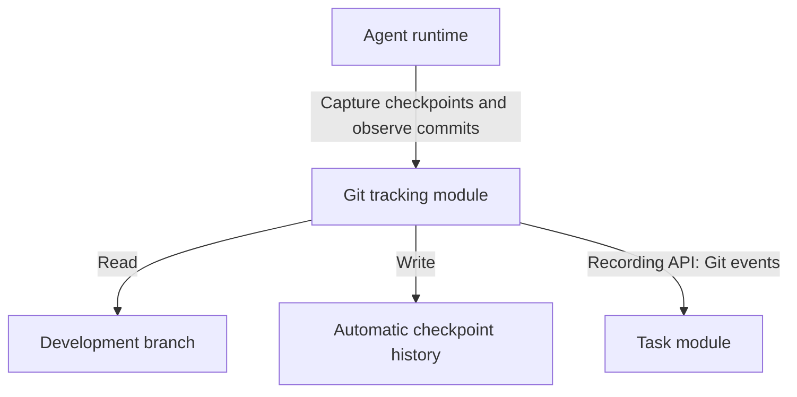
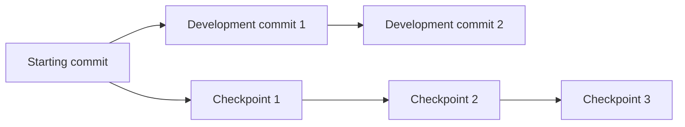

# Git tracking module

[Main architecture](../architecture.md) · [Task module](task-module.md)

Tracks code during a task using two separate histories: explicit development commits and automatic checkpoints. The runtime handles checkpointing; workers continue using ordinary file and Git tools.

## Architecture

## Two histories

| History | Location | Contents |
| --- | --- | --- |
| Development | Normal task branch, such as `task/T-42`. | Commits explicitly created by the user or an agent through Git. |
| Checkpoints | Custom reference, such as `refs/ariadne/checkpoints/T-42/run-1`. | Automatic snapshots of the task workspace, including uncommitted changes. |

Both histories use normal Git commit objects. Checkpoint commits have their own parent chain and reference; automatic checkpointing leaves the development branch, working files, and user staging area unchanged. Checkpoints are kept separate when development changes are merged.

Each checkpoint records `task_id`, `run_id`, `commit_hash`, `development_head`, `reason`, and timestamp. `development_head` identifies the development commit checked out at capture time; it does not mean the two commits contain identical files.

## Interface

| Operation | Caller | Purpose |
| --- | --- | --- |
| `checkpoint(task_id, run_id, reason)` | Runtime | Capture the workspace and return its checkpoint reference. |
| `observe_commits(task_id, run_id)` | Runtime | Record observed development-branch changes and newly reachable commits. |
| `list_checkpoints(task_id)` | CLI, orchestrator | Inspect automatic snapshots. |
| `diff(from_commit, to_commit)` | CLI, context service | Read changes between recorded states. |

The runtime supplies the task's repository and workspace association. It captures an initial checkpoint, checkpoints after file-changing tool calls, and checkpoints before workflow-step handoffs. Capture happens after writes finish. The tracker emits Git events through the task module's internal recording API; workers make no bookkeeping calls.

## Capture rules

Use a separate temporary Git index to build the workspace snapshot, create a commit, and update only the checkpoint reference. Git provides [commit creation](https://git-scm.com/docs/git-commit-tree), [reference updates](https://git-scm.com/docs/git-update-ref), and an [alternate index](https://git-scm.com/docs/git#_environment_variables) for these operations.

Capture tracked files and eligible new files under the configured task workspace; exclude ignored files by default. Record an explicit commit's initiator when it is known from the runtime, otherwise leave it unknown.

Checkpoint retention, remote synchronization, and restore behavior remain open choices. Custom references need an explicit backup policy.
