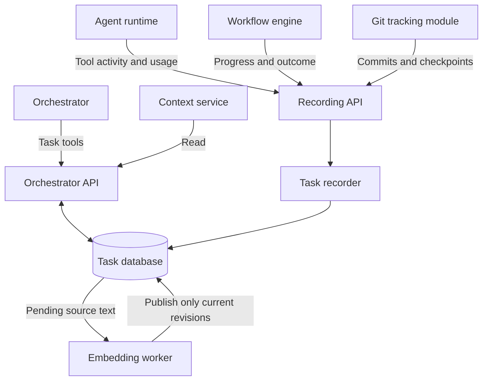

# Task module

[Main architecture](../architecture.md)

Stores tasks and their progress. The orchestrator defines the work; the runtime, workflow engine, and Git tracker update the records automatically. Worker agents have no task-management tools.

The task database also owns persistent execution information from agents, tools, and workflows. Only the orchestrator has saved chat history; live agent/tool UI events are temporary. The recording API below covers current task updates; additional execution details can extend it as needed.

The [Python prototype](../../ariadne/task/__init__.py) implements these APIs with SQLite, a JSON-line CLI, and a rebuildable vector store. Run `python3 -m examples.task_flow` for an in-memory example. Tests are in `tests/task/` and `tests/system/`.

## Architecture

The module has two API parts. The orchestrator API exposes LLM tools to define and inspect tasks. The internal recording API accepts execution events; the recorder translates them into automatic task updates. Both use the same task database. The context service shares the read operations only.

## Task data

Proposed logical fields; these do not require a particular database layout. `ID` is an opaque string, `Text` is a string, timestamps use UTC, and `?` means optional. `List<T>` is a collection of items; an embedding vector is a separate numeric representation used for semantic search.

### Identity

| Field | Type | Meaning |
| --- | --- | --- |
| `id` | `ID` | Stable task identifier. |
| `project_id` | `ID` | Project the task belongs to. |
| `created_at` | `Timestamp` | When the task was created. |
| `updated_at` | `Timestamp` | When the task last changed. |
| `version` | `integer` | Increasing record version; optional optimistic concurrency check on updates. |

The module generates task IDs and timestamps. `project_id` is supplied when creating the task; an LLM tool wrapper can fill it from the active CLI project.

### Goal and organization

| Field | Type | Meaning |
| --- | --- | --- |
| `description` | `Text` | What should be done and why. Good source for a search embedding. |
| `acceptance_criteria` | `List<Text>` | Optional conditions for completion; can also be embedded. |
| `tags` | `List<string>` | Labels for exact filtering, such as `backend` or `bug`. |
| `relations` | `List<TaskRelation>` | Typed relationships to other tasks. |

`TaskRelation` contains `task_id: ID` and a `kind` enum: `blocked_by` or `related_to`. If task A is `blocked_by` task B, B must be resolved before A can proceed. `related_to` records a general association.

The orchestrator LLM supplies these fields through task tools. Collections can be empty.

### Progress and outcome

| Field | Type | Meaning |
| --- | --- | --- |
| `status` | `enum` | Proposed values: `draft`, `ready`, `in_progress`, `blocked`, `completed`, `cancelled`. |
| `current_step` | `string?` | Current workflow step, such as `review`. |
| `state_reason` | `Text?` | Explanation of a blocked or cancelled task. |
| `result_summary` | `Text?` | Latest outcome with references to supporting results. Useful for semantic search. |

The workflow engine supplies progress and outcome events. The recorder updates these fields. Run IDs stay in history and Git references; a separate current-run field is omitted for now.

New tasks start in `draft`. Moving a task to `ready` is handled through the workflow engine; the exact workflow operation remains to be defined. The orchestrator task tools do not expose a general status setter.

### References and code

| Field | Type | Meaning |
| --- | --- | --- |
| `links` | `List<LinkReference>` | Related URLs with an optional label and comment explaining their relevance. |
| `files` | `List<FileReference>` | Linked, consulted, or modified files, with optional comments and code locations. |
| `git_refs` | `List<GitReference>` | Development commits and automatic checkpoints associated with the task. |

The module assigns each reference a stable `id: ID`, allowing comments to target a particular reference.

`LinkReference` contains `url: string`, `label: string?`, and `comment: Text?`.

`FileReference` contains a repository ID, relative path, optional commit hash, relation (`linked`, `consulted`, or `modified`), and optional `comment: Text`. It can also identify a symbol or inclusive line range within that file. Uncommitted locations are provisional until associated with a captured revision.

Comments explain why a reference matters. The orchestrator can supply them; automatic observations may omit them. IDs, paths, URLs, and hashes remain exact references.

`GitReference` contains a repository ID, commit hash, `kind` enum (`development` or `checkpoint`), optional run ID, and optional comment. Checkpoints also record the development HEAD at capture time. The [Git tracking module](git-tracking-module.md) design maintains the separate histories and supplies these references automatically; the prototype accepts its events but does not capture Git checkpoints itself.

### History and usage

| Field | Type | Meaning |
| --- | --- | --- |
| `history` | `List<Event>` | Recorded activity, changes, findings, and results; fetched separately. |
| `input_tokens` | `integer?` | Total input tokens reported by the runtime. |
| `output_tokens` | `integer?` | Total output tokens reported by the runtime. |
| `elapsed_time_ms` | `integer?` | Workflow wall-clock time, in milliseconds. |

An `Event` contains an ID, timestamp, source (`orchestrator`, `runtime`, `workflow_engine`, or `git_tracker`), type, optional run ID, optional text summary, and structured data. Usage totals are derived from execution events; a total remains unknown if contributing measurements are missing. Time is tracked as workflow wall-clock time only.

### Optional semantic-search index

Keep original text and derive embedding vectors for meaning-based search. Start with descriptions and result summaries; meaningful history summaries or referenced text/code chunks can be indexed later. This is the [semantic-search pattern](https://sbert.net/examples/sentence_transformer/applications/semantic-search/README.html) of comparing query and document embeddings.

| Index field | Type | Meaning |
| --- | --- | --- |
| `task_id` | `ID` | Task the indexed content belongs to. |
| `source_ref` | `string` | Source field or history entry; include a chunk ID when splitting long text. |
| `source_revision` | `integer` | Increasing revision of the indexed source text, used to reject stale embedding results. |
| `embedding_model` | `string` | Model/version used to produce the vector. |
| `embedding` | `Vector<float32, N>` | Numeric representation; dimension `N` depends on the model. |

Vectors are generated internally and are not arguments or responses of LLM task tools. Search can combine semantic matches with exact project, status, and tag filters. The vector index is optional and can be rebuilt from source content.

The prototype stores vectors in the same SQLite database as tasks and scans them with cosine similarity. Its offline demo provider uses token hashing; a learned embedding model can be connected through the Python `Embedder` protocol. Only descriptions, acceptance criteria, and result summaries are currently indexed.

### Keeping task and vector data consistent

1. A task edit updates its source text, invalidates affected vectors, and queues embedding work in one database transaction.
2. A worker computes an embedding outside the transaction, then checks the source revision before saving it. An obsolete result is discarded.
3. Saving a current vector and acknowledging its job happen in one transaction. Pending work survives restart.
4. Search includes only matching source revisions and model IDs. It reports index completeness; newly edited tasks may be absent until indexing finishes.

Task data is immediately current; vector availability is eventual. Metadata-only edits keep existing vectors. Removing source text removes its jobs and vectors. Registering a new embedding model queues current sources without mixing vector spaces. See the [prototype instructions](../../README.md#vector-search).

## Interface

LLM tools use the named arguments below. Python callers obtain the orchestrator API from `store.orchestrator()` and pass a `TaskUpdate` to `update_task` or a `SearchQuery` to `search_tasks`. Automatic updates use `store.recorder().record_event(RecordEvent(...))`.

### Orchestrator API

Exposed as LLM tools with explicit named parameters and structured responses. The context service can use the read operations.

| Operation | Purpose |
| --- | --- |
| `create_task(project_id, description, tags?)` | Create a draft task and return its record, including its ID. |
| `update_task(id, description?, acceptance_criteria?, tags?, relations?, links?, files?, expected_version?)` | Edit the task definition and explicit references; optionally reject conflicting edits. |
| `annotate_reference(task_id, reference_id, comment)` | Set a reference's comment, including for automatically discovered files, while preserving the recorded observation. |
| `add_note(task_id, text)` | Append a clarification, decision, or finding to task history. |
| `get_task(id)` | Read the current task, including progress and usage. |
| `search_tasks(project_id, text?, status?, tag?, limit = 20, mode = keyword)` | Return matching summaries; semantic mode also reports scores, model, and index completeness. |
| `get_history(id, limit = 20)` | Read recent task activity and results. |

Omitted update fields stay unchanged; supplied lists replace the explicitly managed entries. Recorded observations are preserved. The orchestrator cannot directly overwrite execution status, observed file changes, Git activity, usage, or execution history. Requests to start, stop, or resume work go through the workflow engine.

Acceptance criteria, relations, links, and explicit file references are already covered by `update_task`; they do not need separate calls initially. Notes append to history, and reference annotations change comments only.

### Automatic recording API

Called by runtime, workflow-engine, and Git-tracking code. It is not exposed as an LLM tool.

| Operation | Purpose |
| --- | --- |
| `record_event(event)` | Append observed activity and apply automatic updates; the typed event includes its task ID. |

| Source | Automatic updates |
| --- | --- |
| Agent runtime | Files consulted or modified, agent results, and token usage. |
| Workflow engine | Current step, status, state reason, workflow outcome, and elapsed time. |
| Git tracking module | Development commits, automatic checkpoints, and their Git references. |

Initial event types make the write path for each automatic field explicit:

| Event | Source | Information recorded |
| --- | --- | --- |
| `workflow_status_changed` | Workflow engine | Task-wide sequence number, `status`, `current_step`, and optional `state_reason`. |
| `workflow_finished` | Workflow engine | Task-wide sequence number, run ID, final status, `result_summary`, and `elapsed_time_ms`. |
| `files_observed` | Runtime | File references, consulted/modified relation, and optional code locations. |
| `agent_result_recorded` | Runtime | Agent result or result reference in history; the workflow selects the final task summary. |
| `git_recorded` | Git tracker | Development or checkpoint references, including the development HEAD for a checkpoint. |
| `usage_recorded` | Runtime | Model-call identity and input/output token counts contributing to task totals. |

Reading a file records it as consulted; observed changes record it as modified. Events carry unique IDs so recording the same event twice does not duplicate history or usage. The module also records orchestrator edits in history automatically.

When semantic search is enabled, the module refreshes embeddings after source text changes. No LLM-facing embedding-write operation is needed.

The prototype uses explicit indexer calls; automatic background scheduling is still open. Workflow events must arrive in sequence; out-of-order events return a conflict for the producer to retry. Python data types are in [model.py](../../ariadne/task/model.py); CLI examples are in the [README](../../README.md).
