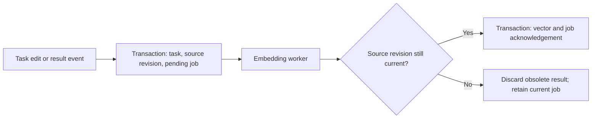

# Ariadne prototype

Rust prototype with an [orchestrator](architecture/modules/orchestrator-module.md), local chat UI, [shared LLM access](architecture/modules/llm-module.md), [application commands/events](architecture/modules/interaction-module.md), [tasks](architecture/modules/task-module.md), and [configuration](architecture/modules/configuration-module.md). OpenRouter is the first API adapter.

## Layout

Modules live in `src/task/`, `src/configuration/`, `src/llm/`, `src/interaction/`, and `src/orchestrator/`, with matching integration-test folders. Browser assets, the local HTTP frontend, and the terminal frontend live in `src/ui/`. The library exposes these modules under `ariadne_tasks`. The root CLI selects `chat` or `config`; existing task commands keep their original syntax.

[System tests](tests/system/README.md) include a reusable SQLite database with 30 dependent tasks describing an Android AI chat app, plus its source plan and seed generator. Run them with `cargo test --test system`.

## Run

Requires Rust 1.89+ (for standard file locking) and a system SQLite library with JSON functions (SQLite 3.38+ recommended). On Debian/Ubuntu the native build dependency is `libsqlite3-dev`; on Arch it is `sqlite`. Cargo dependencies are pinned in `Cargo.lock`.

Live model access also requires `curl` on `PATH`. The embedded UI needs no frontend build or package installation.

```sh
cargo test --locked
cargo run --locked --example task_flow
cargo run --locked -- --help
cargo run --locked -- --tools
cargo run --locked -- config --help
cargo run --locked -- chat --help
```

## Chat with the orchestrator

Initialize an empty configuration directory with your chosen OpenRouter model ID, then start the app with an API key in its environment:

```sh
cargo run --locked -- chat init --model 'YOUR_OPENROUTER_MODEL_ID'
export OPENROUTER_API_KEY='YOUR_API_KEY'
cargo run --locked -- chat --project ariadne
```

Open **http://127.0.0.1:8787**. The UI supports conversations, streamed replies, tool activity, stopping a turn, and a project-task sidebar. Use `--port` to change the port, `--root` to change the configuration directory, or `--db` to choose task storage. For terminal chat, add `--terminal`; commands include `/new`, `/sessions`, `/use ID`, `/stop`, and `/quit`.

The orchestrator can create/edit/search tasks and inspect configured profiles/workflows. Tasks start in `draft`. Agent execution, workflow execution, repository tools, and Git capture remain future modules. Semantic task search still uses the token-hash demo embeddings described below.

Only orchestrator chat history is saved, in `.ariadne/orchestrator.sqlite`. Its prompts, tool dialogue, and configuration snapshot let later turns continue the conversation. Task records stay in the task database; live activity and text fragments are temporary. New conversations use current configuration, while existing conversations keep their original snapshot. Interrupted tools are not replayed automatically.

`chat init` refuses to overwrite existing configuration. For older profiles, create an API connection using `config --role editor` and `save_provider`, then save the profile with a `provider_id` and remove its old `credential_ref`. Choose a real model ID; the older configuration example uses placeholder model names.

To explore the Android fixture in the chat UI, copy it first, then run chat with that project:

```sh
cp tests/system/fixtures/android-chat.sqlite /tmp/ariadne-android.sqlite
cargo run --locked -- chat --project android-ai-chat --db /tmp/ariadne-android.sqlite
```

## Shared interfaces

Any component can call `llm::Gateway::generate` with a binding resolved from a configuration snapshot. The OpenRouter adapter handles HTTP/SSE, complete tool calls, continuation metadata, usage, errors, and cancellation. Callers own prompt rendering, history, and tool execution. See [examples/llm_call.rs](examples/llm_call.rs) for a direct call; running it makes a live API request.

`interaction::Interface` provides bounded command and event channels. Modules publish structured output with session/source/work IDs; the CLI/UI subscribes and submits user commands. The initial application handles chat and cancellation. `respond_to_input` is defined for future workflows and currently reports an unsupported operation. The policy for agent/tool questions remains open.

## Task CLI

The demo runs entirely in memory. The CLI persists to `ariadne.sqlite` by default. Use `--db PATH` to select a database. It consumes one JSON object per line and returns one response per line:

```sh
echo '{"op":"create_task","project_id":"demo","description":"Build task search","tags":["backend"]}' |
  cargo run --locked -- --db /tmp/ariadne-demo.sqlite

echo '{"op":"search_tasks","project_id":"demo","text":"search"}' |
  cargo run --locked -- --db /tmp/ariadne-demo.sqlite
```

Responses have either `{"ok":true,"result":...}` or `{"ok":false,"error":{"code":...,"message":...}}`. The process continues after an invalid request. `--tools` prints JSON Schema descriptions for the seven orchestrator tools; an LLM adapter adds `op` using the selected tool name.

## Configuration module

Initialize an example configuration in an empty directory. This saves eight profiles, four prompt templates, a code → review → test workflow, and a fixed snapshot. Example model names are placeholders; no LLM or tools are executed.

```sh
cargo run --locked --example configuration_flow -- /tmp/ariadne-config-demo

echo '{"op":"list_profiles","component":"agent"}' |
  cargo run --quiet --locked -- config --root /tmp/ariadne-config-demo

echo '{"op":"validate"}' |
  cargo run --quiet --locked -- config --root /tmp/ariadne-config-demo

echo '{"op":"save_prompt","id":"greeting","text":"Hello {{name}}","variables":["name"]}' |
  cargo run --quiet --locked -- config --root /tmp/ariadne-config-demo --role editor
```

The initializer refuses to replace existing configuration. The default directory is `.ariadne/` and default CLI role is `reader`. Configuration edits require `--role editor`; runtime code can read, render, and snapshot configuration. `config --tools` exports four discovery/read tool schemas with no editing operations. API connections store only credential references such as `env:OPENROUTER_API_KEY`; the LLM module resolves them at request time. Use `list_providers`, `get_provider`, and editor-only `save_provider` to manage connections.

`ConfigurationStore` supports profile/prompt/workflow saves, coordinated `replace_configuration`, revision checks, validation, and saved snapshots. A snapshot contains full prompt text and configuration at one revision; load it by ID for a run so later edits cannot change that run's instructions. Prompt variables use `{{name}}`, and required inputs are checked during rendering. Referenced profiles, workflow inputs/transitions, execution limits, and known settings are validated before publishing changes. A future runtime can verify tool IDs against its registry using `Configuration::validate_tools`.

See the [configuration module](architecture/modules/configuration-module.md) for its interface and file layout. Run its tests with `cargo test --test configuration`.

## Two task APIs

- `TaskStore::orchestrator()` supports create/update/read/search, notes, annotations, and history. Typed update arguments contain no status, token, or observed-Git setters. An optional `expected_version` detects conflicting edits.
- `TaskStore::recorder()` accepts typed workflow, usage, file, result, and Git events. Event IDs are idempotent; reused IDs with different content are rejected. Model-call IDs also prevent duplicate usage accounting.

The CLI defaults to `--role orchestrator`. Internal operations require a separate `--role recorder` or `--role indexer` invocation. These are local API boundaries, not an authenticated remote service. The prototype implements task recording, not an agent runtime, workflow executor, or Git checkpoint capture.

A recorder request looks like this (replace the task ID):

```json
{"op":"record_event","event":{"id":"workflow-ready-1","task_id":"TASK_ID","run_id":"run-1","change":{"type":"workflow_status_changed","sequence":1,"status":"ready"}}}
```

Workflow state events use a persistent sequence per task, starting at 1 across all its attempts. Out-of-order events are rejected for producer retry. New tasks start in `draft`; the recorder accepts `draft → ready → in_progress`, then `blocked`, `completed`, or `cancelled`. Use `workflow_finished` for completion and its summary/duration. Sources are inferred from event types. Only the application should receive recorder access.

## How task and vector data stay consistent

There is one authoritative database. Vectors are a rebuildable view of source text, not another independently maintained task record.

1. A transaction writes the task and history, updates changed source revisions, removes affected vectors, and queues embedding jobs. All of it commits together.
2. A worker reads pending source text and generates embeddings outside the write transaction.
3. A second transaction checks that the source revision is still current. If it changed, the result is obsolete and the current job remains pending. Otherwise it publishes the vector and removes the job atomically.
4. Vector search joins the current source revision, selected model, and current task/project filters. Stale vectors never participate. Responses expose index coverage, so an unfinished index cannot silently appear complete.

The index is **eventually complete, with current-only results**. During embedding delays or failures, keyword search continues to use current task data; vector search may temporarily omit changed tasks. Failed jobs survive restart and can be retried. Source deletion cascades to jobs and vectors. Source revisions never repeat after remove/re-add edits. Non-text metadata changes do not trigger re-embedding.



SQLite supplies [atomic transactions](https://www.sqlite.org/atomiccommit.html); foreign keys are enabled on every connection. Tasks and reference collections are currently JSON-backed records, while source revisions, work queues, usage-call identities, and vectors have dedicated tables. A small ownership-safe SQLite C API adapter links to the installed library.

## Try the vector index

```sh
echo '{"op":"index_pending","limit":200}' |
  cargo run --locked -- --db /tmp/ariadne-demo.sqlite --role indexer

echo '{"op":"search_tasks","project_id":"demo","text":"task search","mode":"semantic"}' |
  cargo run --locked -- --db /tmp/ariadne-demo.sqlite

echo '{"op":"index_status","project_id":"demo"}' |
  cargo run --locked -- --db /tmp/ariadne-demo.sqlite --role indexer
```

`index_pending` processes one bounded batch. Run it again until the project's `index_status.complete` is true. `rebuild_index` queues all current sources for the demo model and removes its derived vectors, without modifying tasks or history.

**The CLI's `DemoEmbedder` uses deterministic token hashing, not a learned semantic model.** It makes vector lifecycle behavior testable offline. It matches shared tokens and can have hash collisions. The library's `Embedder` trait accepts a real local or remote provider without changing the database protocol. The provider ID must identify the embedding model, preprocessing, and vector-space version. Registering a new ID backfills existing sources. Vectors from different model IDs are never mixed.

For this prototype, vectors are stored as JSON arrays in SQLite and ranked with an exact cosine scan in Rust. There is no ANN index or separate vector service. Initially only descriptions, acceptance criteria, and workflow result summaries are embedded; notes, reference comments, and code chunks remain outside the vector index. Exact search supports current text, reference material, and notes. There is no automatic background daemon: the indexer is explicitly invoked or driven through the library.

Tests cover task/reference operations, role boundaries, event replay, workflow sequencing, restart recovery, delayed workers, source removal/re-addition, model changes, project filters, provider failures, and injected failures between transactional writes.

## Verification

```sh
cargo test --locked
cargo fmt --all -- --check
cargo clippy --locked --all-targets -- -D warnings
node --test tests/ui/chat.test.cjs
```

Default tests use mock model responses and make no paid API calls. Two additional real-HTTP transport tests require local sockets and are opt-in: `cargo test --test llm -- --ignored`. The restricted development sandbox blocks sockets, so live OpenRouter calls and a browser-server launch were not verified there. HTTP routing, streaming assembly, subprocess transport/cancellation, and UI state transitions have tests that run without sockets.

The subprocess fixture tests use Python 3 on Unix. The separate UI state tests require Node.js; neither is needed to run the chat UI.
