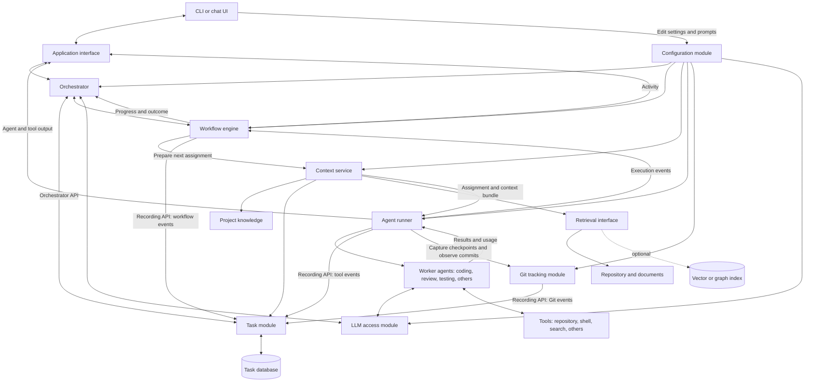

# Ariadne: Technical Reference

Start with the [architecture overview](architecture.md). This reference contains detailed module descriptions, execution rules, and example configuration. The [task module](modules/task-module.md) combines its architecture and initial interface.

Status: Initial design for discussion. Component boundaries reflect the described system; implementation details below are proposals unless explicitly identified as requirements. The YAML example is illustrative and is not an implemented schema.

## Purpose

Ariadne coordinates LLM agents working on a project. A user communicates with an orchestrator through a CLI, which carries requests, progress, and results. The orchestrator manages persistent tasks and follows configurable workflows such as **code → review → testing**.

## System overview



Open [Task module details](modules/task-module.md) if the viewer does not support clickable Mermaid nodes. Its recorder consumes the runtime and workflow events shown above.

The orchestrator owns coordination and communication with the user. Worker agents receive a bounded assignment and return a result. The task module owns persistent task data. The workflow engine owns execution order and transitions, while the context service owns preparation of an agent's input context.

## Components

### User interface and orchestrator

The CLI uses the shared [application interface](modules/interaction-module.md) for commands and events. It displays orchestrator replies alongside workflow, agent, and tool activity, with session and work IDs keeping concurrent output associated with its source. The policy for routing agent/tool questions to the user remains open.

Only the orchestrator conversation is saved as chat history. Persistent agent/tool execution results, workflow progress, usage, and errors belong in the task database through the recording API. Live UI events are temporary; reconnecting loads the orchestrator conversation and task records.

The [orchestrator/chat prototype](modules/orchestrator-module.md) now implements conversation persistence, task/discovery tools, streaming replies, cancellation, and browser/terminal frontends through the shared application interface. Worker execution remains future work.

The orchestrator:

- Interprets user requests and creates or updates tasks through the task module.
- Selects an agent or starts a configured workflow for a task.
- Supplies the task, project, and execution constraints to the workflow engine.
- Tracks results, communicates progress, and requests user input when needed.
- Can stop or revise work through the workflow engine.

Proposed boundary: the orchestrator decides what work should happen; the workflow engine carries out the selected sequence. Direct agent calls use the same runner and tracking path as a one-step workflow.

### Task module

The task module stores the goal, references, history, state, and usage for each task. Its orchestrator API provides LLM tools to define and inspect tasks. Its internal recording API accepts runtime, workflow, and Git-tracking events, which the recorder uses to maintain execution information automatically. Worker agents receive task context and do not call either API.

The [task module](modules/task-module.md) contains a simple architecture diagram, task data, and an initial interface. Detailed lifecycle and reliability rules are deferred.

#### Task data model

See [task data](modules/task-module.md#task-data) and the [interface sketch](modules/task-module.md#interface). Tasks retain descriptions, links, Git references, files/code parts, history, status, tags, tokens, and time; exact representations remain open.

### Git tracking module

The [Git tracking module](modules/git-tracking-module.md) records development commits and automatic checkpoints in separate histories. Runtime-triggered checkpoints use custom references and preserve the development branch and staging area. The tracker sends Git references to the task recorder.

### Task storage and search

The [Rust task-module prototype](../README.md) uses SQLite for tasks, history, references, usage, source text, embedding jobs, and vectors. Workflow and agent execution are still outside the prototype.

The prototype implements project-scoped filters, text search, and exact cosine vector search. Task edits, source revisions, vector invalidation, and pending embedding work commit atomically. Embeddings are generated afterward and published only if their source revision is still current; search reports incomplete coverage while work is pending. Vector storage is a rebuildable part of the same database. A separate vector service or graph index can be considered later.

The task API exposes task search independently of the storage technology. The context service can combine task search with repository and project-document retrieval.

### Agent definitions and runner

The shared [LLM access module](modules/llm-module.md) now provides model requests with an OpenRouter adapter. API connections and model selection belong to configuration; adapters handle transport, streaming, tool-call representations, usage, and errors. Callers retain their conversation and tool execution loops.

The [configuration module](modules/configuration-module.md) prototype stores component profiles, Markdown prompt revisions, and workflow definitions using a versioned JSON manifest. It provides validated saves, revision checks, prompt rendering, and self-contained run snapshots. The orchestrator, context service, workflow engine, and runtime will load their settings from it. Configuration edits are made through the CLI's editor role.

An agent definition describes an agent's role and configuration:

- Name, purpose, and prompt/instructions.
- Model configuration.
- Available tools and their permissions.
- Context requirements and token budget.
- Expected output format and completion criteria.

The agent runner turns a definition into an execution. It receives the assignment and context prepared for the workflow step, invokes the model and tools, enforces execution limits, and returns a structured result. Each run records its task, workflow step, agent-definition version, model, context references, timestamps, usage, outcome, and errors.

Example roles are coding, reviewing, and testing. Definitions remain separate from workflow order so the same agent can be reused in different workflows.

Tool access is explicit per worker agent and includes repository tools, command execution, and search as needed. Workers have no task-management tools. The runtime observes tool results and emits structured events; the task module's recorder updates references, history, and usage automatically. The workflow engine supplies lifecycle events. The orchestrator retains the task command/query interface.

### Project knowledge

Each project has a maintained knowledge space for details that agents need:

- Project purpose, requirements, and terminology.
- Architecture and component responsibilities.
- Coding conventions and repository layout.
- Build, test, and development instructions.
- Design decisions and known constraints.

The storage format and editing interface are undecided. A proposed starting point is versioned project documents plus structured project metadata. Knowledge can be marked as required for every run, relevant to a role, or available through retrieval.

Project knowledge supplies shared context across tasks. Task descriptions and history supply the context specific to the current piece of work.

### Context service

The context service runs between the workflow engine and agent runner for every step: workflow engine → context service → agent runner → results back to the workflow engine. It prepares a context bundle before an agent starts. An agent may also request additional context during execution through a retrieval tool.

Inputs include the task ID, project ID, agent role, workflow step, repository revision, and context budget. The service:

1. Loads required project instructions and the current task.
2. Loads relevant history and preceding workflow-step results.
3. Resolves explicitly linked files and code references.
4. Retrieves additional documents, code, or related tasks as needed.
5. Selects and, when appropriate, summarizes material to fit the budget.
6. Returns a context bundle with source references and revision metadata.

The runner inserts this bundle into the agent's initial input using the model adapter's supported message structure. The agent's role instructions and retrieved source material remain distinguishable; retrieved content is reference data, not authority to change tool permissions or execution rules.

A dedicated retrieval LLM is an optional implementation behind this service. It could formulate searches, traverse relationships, and select relevant material. The same service contract can initially be implemented with explicit links, text search, and deterministic selection. Whether to use another LLM, a vector database, a graph database, or a combination remains open.

Each bundle should record which sources and summaries were supplied. Retrieval must respect the current repository revision and identify stale indexed content. If required context cannot fit or be retrieved, the service should surface that limitation rather than silently omit requirements.

### Workflow engine

Workflows provide the structured, changeable way agents are called. A workflow definition contains named steps, agent references, input/output mappings, and transition conditions. It can also specify retry limits, execution budgets, and optional user checkpoints.

The engine instantiates a definition for a task, calls the runner for each step, persists execution state, and evaluates transitions from recorded results. A review or test step can return work to coding, with its findings included in the next agent's context.

An illustrative configuration follows. This is a design sketch, not an implemented configuration schema:

```yaml
name: implement-review-test
version: 1
start: code
limits:
  max_step_executions: 12
steps:
  code:
    agent: coder
    inputs: [task, project_context, latest_findings]
    transitions:
      completed: review
      blocked: blocked
  review:
    agent: reviewer
    inputs: [task, project_context, latest_code_result, current_diff]
    transitions:
      approved: test
      changes_requested: code
      blocked: blocked
  test:
    agent: tester
    inputs: [task, project_context, latest_code_result, latest_review_result]
    transitions:
      passed: completed
      failed: code
      blocked: blocked
terminal_states: [completed, blocked, failed, cancelled]
```

Infrastructure errors are handled separately from review findings or failed tests. The engine applies bounded retries for infrastructure errors and records failure if recovery is exhausted. Reaching a workflow limit pauses or terminates work according to an explicit policy; it must not create an unbounded correction loop.

Proposed rule: a running workflow retains the version it started with. Editing a definition affects new runs; changing an active run requires an explicit recorded action. Persisted step state allows interrupted runs to be inspected and resumed, with care around tools that may already have performed side effects.

## Example end-to-end flow

1. A user asks Ariadne to implement a change.
2. The orchestrator creates a task containing the description, references, and relevant repository revision.
3. The orchestrator selects the code → review → testing workflow.
4. The workflow engine sends the coding assignment to the context service, which prepares a context bundle and passes it to the runner. The runner invokes the coding agent with its permitted tools. Each subsequent step follows the same context-preparation path.
5. The runner records the result, code references, token usage, and duration. The workflow engine records progress through the task module.
6. The reviewer receives the task requirements, current diff, relevant project knowledge, and coding result. Requested changes return the workflow to coding.
7. After review approval, the testing agent runs the appropriate checks. Failures return findings to coding and the revised work passes through review again.
8. When the configured completion conditions are met, the engine records completion and the orchestrator reports the outcome to the user.

## Initial implementation direction

Proposed starting structure: one application with distinct modules for orchestration, tasks, configuration, LLM access, the application interface, workflows, agents/tools, context, and project knowledge. These boundaries do not require separate deployed services. Define shared LLM access and command/event interfaces before implementing the orchestrator and chat UI.

An initial usable version would provide persistent task operations, versioned project instructions, configurable sequential workflows with correction loops, an agent runner, and context assembly from explicit references plus search. Semantic or graph retrieval and a dedicated retrieval agent can be added behind the context interface as their requirements become clearer.

## Open decisions

- May agents and tools request user input directly, or must questions go through the orchestrator?
- What LLM retry, model fallback, and cancellation policies should be configured?

- Which database and deployment model should be used?
- Does `git_hash` represent the starting commit, the resulting commit, or should both be stored?
- Is a task assigned one tag or multiple tags?
- How are project instructions maintained, and which instructions must be included in every agent run?
- Is basic search sufficient initially, or is LLM-assisted, vector, or graph retrieval required?
- Who selects and edits workflows: the user, the orchestrator, or both?
- Which agent outputs and external checks are required before a task is completed?
- Will agents run concurrently, and how will repository workspaces and conflicting edits be isolated?
- What execution limits, cancellation behavior, and human approval points are needed?
