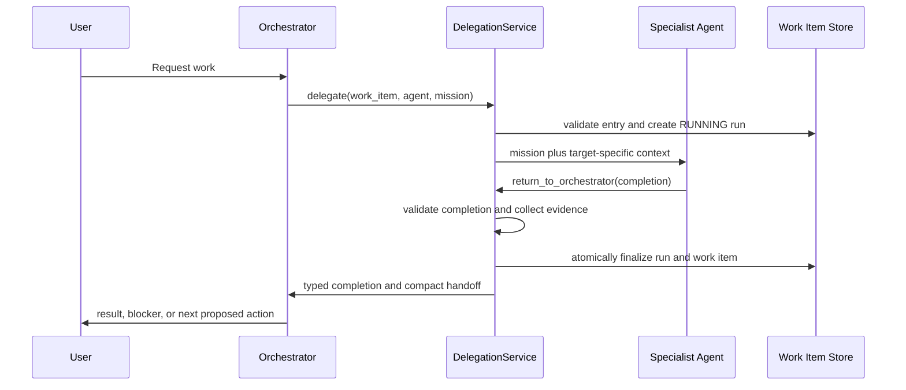

# Agent Delegation Implementation Plan

Status: In progress; Phase 2 complete
Last updated: 2026-07-15

## 1. Objective

Make every specialist-agent execution a durable, validated delegation that:

1. Starts from a valid work item and workflow state.
2. Receives compact, role-relevant context.
3. Returns a typed result to the Orchestrator.
4. Preserves complete success and failure diagnostics.
5. Applies status, gate, artifact, commit, and context updates consistently.
6. Leaves the repository and work item in a known state.

The Orchestrator owns routing and workflow transitions. Specialist agents perform
role-specific work and report results; they do not choose the next agent or
directly advance the workflow.

## 2. Agreed Design Decisions

- Agent-run records are the authoritative source for specialist handoffs.
- Handoff data must be consolidated, not removed.
- Failed runs retain more diagnostic detail than successful runs.
- Context entries hold human decisions, clarifications, and compact derived
  handoffs that reference their source agent run.
- Raw tool logs and failure diagnostics remain available for audit, but they are
  not injected into every subsequent agent prompt.
- Every specialist run terminates through one typed return tool and returns
  control to the Orchestrator.
- The workflow policy is the single source of truth for phase owner, entry
  requirements, allowed operations, gates, and next status.
- A wrong-phase delegation is rejected. The system must not force a work item
  into a requested agent's phase just to make the delegation possible.
- Ticket finalization is atomic: run completion, ticket status, gates, artifact
  links, commits, and handoff context either succeed together or roll back.

## 3. Current State

The repository already provides:

- SQLite `agent_runs` and `context_entries` tables.
- Structured `SUCCESS` and `FAILED` completion payloads.
- Automatic Git evidence collection.
- Artifact and commit attachment after successful runs.
- Failed-run blocking for explicit, valid `FAILED` completions.
- Target-agent context bundle prioritization.
- Unit coverage for normal successful and failed handoffs.
- An application-level delegation service with typed specialist returns.
- Durable cancellation, malformed-completion, duplicate-return, and exception
  finalization paths.
- Coordinator routing for specialists selected directly in the UI.

Known gaps:

- SQLite stores ticket priority, but `WorkItem` does not expose it.
- Stable IDs, parent relationships, dependencies, and acceptance criteria are
  mainly free-form Markdown conventions.
- `shared_context` duplicates structured context entries.
- Normal ticket rendering includes unbounded tool logs and comments.
- Agent-run summaries and handoff context duplicate some information.
- Tool guards validate work item state but not whether the calling agent owns
  that state.
- Specialist prompts and actual tool policies disagree in several places.
- The complete test suite includes two stale workflow-guard failures even though
  the unit suite passes.

## 4. Target Execution Flow



## 5. Data Contracts

### 5.1 Core Work Item

Keep in the core work item:

- ID, title, type, priority, status, description.
- Created and updated timestamps.
- Gate states.
- Target branch, feature branch, base commit, and merge request reference.
- Relevant commit references.
- Artifact references.

Add structured fields or related records for:

- Stable work item ID.
- Parent, child, dependency, and blocker relationships.
- Goal and acceptance criteria.
- Blocked reason and resumable status.
- Status transition history.

Keep operational history in related records rather than embedding all of it in
the normal agent-facing ticket response:

- Agent runs.
- Context entries.
- Tool audit records.
- Status transition records.
- Comments.

### 5.2 Agent Completion

Create one validated, versioned `AgentCompletion` model shared by the terminal
tool, coordinator, persistence layer, and tests.

Required fields:

```text
schema_version
status: SUCCESS | FAILED
summary
```

Optional structured fields:

```text
details
decisions[]
blockers[]
artifacts[]
verification[]
gate_decision
```

Each artifact should support:

```text
title
url or path
type
stable_id
metadata
```

Agents must not provide Git status, changed files, commit hashes, next agent, or
next workflow status. Those are system-owned values.

### 5.3 Durable Failed-Run Record

Every failed run must preserve:

- Agent name, task, start time, end time, and entry ticket status.
- Normalized run status.
- Semantic summary, details, decisions, and blockers.
- Raw agent response, limited to 20,000 characters per run.
- Exception type, message, and optional traceback for internal failures.
- Branch, starting commit, ending commit, commit range, changed files, and final
  worktree state.
- Produced artifacts and verification attempts.
- Resulting ticket status and resumable status.

The raw response and traceback are diagnostic data. The next agent receives only
the relevant summary, blockers, recovery instructions, and source run ID.

### 5.4 Context Bundle

The context bundle is a projection, not another source of truth. It should
contain:

- Work item identity, current phase, goal, and acceptance criteria.
- Relevant gates and relationships.
- Targeted artifacts with stable IDs and traceability metadata.
- Relevant human decisions and clarifications.
- Compact summaries from relevant previous agent runs, including failed runs.
- Git baseline needed by the target role.
- Explicit omissions when context is truncated.

Apply one total size budget to the complete bundle. Do not independently spend
the full limit on artifacts, context entries, and agent runs.

## 6. Implementation Phases

### Phase 1: Ticket and Handoff Contracts

- [x] Add `priority` to `WorkItem` and its SQLite mapping.
- [ ] Define typed work item relationship and status-history models.
- [x] Define versioned `AgentCompletion`, artifact, verification, gate-decision,
      and failure-diagnostic models.
- [x] Extend `AgentRun` with entry status, exit status, raw response, and
      diagnostics.
- [x] Add backward-compatible SQLite migrations.
- [x] Document retention and truncation rules for raw responses and diagnostics.
- [ ] Separate normal ticket, context, and audit projections.

Acceptance criteria:

- Existing databases open without manual migration.
- Existing run records remain readable.
- Failed runs can be reconstructed without relying on comments or legacy shared
  context.
- Normal agent context excludes full tool logs and raw diagnostics.

### Phase 2: Central Delegation Service

- [x] Introduce an application-level `DelegationService`.
- [x] Move run creation, evidence collection, completion parsing, normalization,
      and finalization out of `OrchestratorAgent`.
- [x] Add a terminal `return_to_orchestrator` tool, retaining
      `finish_agent_run` temporarily as a compatibility alias.
- [x] Require exactly one terminal completion per specialist run.
- [x] Route malformed completions and exceptions through the same failed-run
      finalizer.
- [x] Return a typed completion to the Orchestrator instead of relying on marker
      parsing throughout the application.
- [x] Ensure directly selected specialists also run through the coordinator and
      return to the Orchestrator.

Acceptance criteria:

- Every started specialist run reaches SUCCESS, FAILED, or CANCELLED.
- No specialist result terminates directly at the user in normal workflow mode.
- Explicit failure, malformed output, cancellation, and exceptions produce
  consistent durable records.

### Phase 3: Clean Entry, Ownership, and Finalization

- [ ] Use workflow policy to resolve the owner for the current status.
- [ ] Reject delegation when the requested agent does not own the current phase.
- [ ] Reject entry when required gates, artifacts, relationships, or dependencies
      are incomplete.
- [ ] Reject entry when another RUNNING agent run exists for the ticket.
- [ ] Add a SQLite uniqueness constraint for one RUNNING run per ticket.
- [ ] Reject technical delegation when the Git worktree is dirty.
- [ ] Add runtime delegation context containing work item ID, agent name, run ID,
      and entry status.
- [ ] Make tool policy evaluate both agent identity and workflow state.
- [ ] Remove specialist ownership of normal status transitions.
- [ ] Validate success postconditions before advancing the ticket.
- [ ] Preserve resumable status when blocking a ticket.
- [ ] Implement atomic SQLite finalization.

Success behavior:

- Required artifacts and gate decisions exist.
- Required verification passed.
- Git evidence is internally consistent and the final worktree is clean.
- The coordinator advances to the workflow's configured next state.

Failure behavior:

- The run is finalized as FAILED.
- The ticket is moved to Blocked.
- The previous phase is preserved as the resumable status.
- Detailed diagnostics remain in the run record.
- A concise blocker summary is posted to the ticket and context bundle.

Cancellation behavior:

- The run is finalized as CANCELLED.
- The ticket does not advance.
- Partial work and Git state are recorded for recovery.

### Phase 4: Agent Tool Matrix

Implement missing tools:

- [ ] `update_description` for Orchestrator backlog refinement.
- [ ] Parent, child, relationship, dependency, and blocker queries.
- [ ] Content search for specialist agents.
- [ ] Patch-based file editing for writing agents.
- [ ] Read-only Git diff and commit-range inspection.
- [ ] Test and validation execution for Tester and QA.
- [x] Typed `return_to_orchestrator` for all specialists.

Remove or restrict inappropriate tools:

- [ ] Remove `write_file` from QA.
- [ ] Remove normal status and gate transitions from specialists.
- [ ] Remove direct artifact, commit, Git metadata, and shared-context mutations
      from specialists after completion finalization supports them.
- [ ] Do not expose push behavior unless it is explicitly designed and separately
      approved.
- [ ] Guard checkout and other repository-changing tools with delegation context.

Target role matrix:

| Role | Work item | Files/search | Git | Execution | Terminal return |
| --- | --- | --- | --- | --- | --- |
| Orchestrator | Read/create/refine/route | Read/search | Read-only evidence | None | Not applicable |
| Requirements | Read context | Read/search/write/patch docs | Status/diff/branch/stage/commit | Optional doc validation | Required |
| QM | Read context | Read/search | Read-only diff | Optional doc validation | Required |
| Architect | Read context | Read/search/write/patch docs | Status/diff/branch/stage/commit | Validation commands | Required |
| Developer | Read context | Read/search/write/patch code | Status/diff/branch/stage/commit | Build/test commands | Required |
| Tester | Read context | Read/search/write/patch tests | Status/diff/branch/stage/commit | Test commands | Required |
| QA | Read context | Read/search | Read-only status/diff | Validation commands | Required |

Add tests that compare each role's workflow permissions, configured policy,
resolved callables, and prompt tool documentation.

### Phase 5: Prompt Rewrite

- [x] Create one shared specialist completion and tool-discipline fragment.
- [ ] Ensure dynamic mission instructions are injected by the normal application
      path, not only by legacy scripts.
- [ ] Make the Orchestrator use workflow policy instead of a hardcoded status map.
- [ ] Tell specialists not to choose the next agent or status.
- [x] Tell specialists to return semantic data through
      `return_to_orchestrator`.
- [ ] Remove references to nonexistent tools such as `search_file_content`.
- [ ] Remove mandatory hidden-reasoning or `<thought>` instructions.
- [ ] Remove unsupported assumptions about parent tickets until relationship
      tools are available.
- [ ] Remove direct status, gate, artifact-link, and commit-metadata instructions
      from specialists.
- [ ] Align Developer, Tester, QA, and QM validation instructions with their real
      tool sets.
- [ ] Resolve policy prompt paths that currently point to files that do not exist.

All specialist prompts must require:

1. Read the delegated mission and target-specific context.
2. Confirm the current work item before mutating project files.
3. Stay within the role boundary.
4. Verify produced work using available tools.
5. Return exactly one typed semantic completion.

### Phase 6: Evidence and Context Hardening

- [ ] Preserve artifact metadata, including stable IDs.
- [ ] Record all commits created during the run, not only the latest commit.
- [ ] Include staged, unstaged, and untracked files in final evidence.
- [ ] Reject SUCCESS when the final worktree violates the role's cleanliness
      policy.
- [ ] Add context priorities for Requirements and QM.
- [ ] Make context ordering deterministic and readable.
- [ ] Add total token or character budgeting with explicit truncation markers.
- [ ] Migrate legacy `shared_context` into structured records before removing it.

### Phase 7: Integration, Migration, and Documentation

- [ ] Add real SQLite integration tests with fake specialist agents.
- [ ] Cover success, explicit failure, malformed output, exception, cancellation,
      duplicate run, wrong-phase entry, dirty Git, missing artifact, failed
      verification, metadata preservation, and transaction rollback.
- [ ] Cover manual specialist selection returning to the Orchestrator.
- [ ] Add migrations and tests for existing local databases.
- [ ] Repair or replace the two stale workflow-guard tests.
- [ ] Update architecture, workflow, ticket, and operator documentation.
- [ ] Run a fresh end-to-end smoke workflow on work item #17.

## 7. Recommended Delivery Order

Implement the plan as small vertical slices that leave the repository usable:

1. Typed completion and failed-run persistence.
2. Unified finalizer for success, failure, malformed output, and exceptions.
3. Delegation service and automatic return to Orchestrator.
4. Entry ownership and single-running-run enforcement.
5. Atomic workflow finalization.
6. Tool matrix corrections and missing tools.
7. Prompt rewrite based on the final contracts and tools.
8. Context budgeting, migrations, integration tests, and live smoke test.

Each slice should include model/store changes, migrations, focused unit tests,
integration tests where persistence is involved, and documentation updates.

## 8. Definition of Done

The delegation work is complete when:

- Every specialist execution has a durable start and terminal run record.
- Every specialist returns control to the Orchestrator.
- Failed runs preserve semantic failure information and diagnostic evidence.
- No wrong-role agent can mutate a ticket phase it does not own.
- No ticket can have multiple active specialist runs.
- Workflow transitions occur only after validated postconditions.
- Ticket, run, artifact, gate, commit, and context updates are atomic.
- Agent prompts mention only real tools and match policy permissions.
- Context bundles are compact, deterministic, role-relevant, and traceable to
  authoritative records.
- Existing local databases migrate without data loss.
- Unit and integration tests pass.
- A real REQ -> QM -> ARCH -> DEV -> TEST -> QA smoke workflow succeeds or
  produces a complete, resumable failure record.
